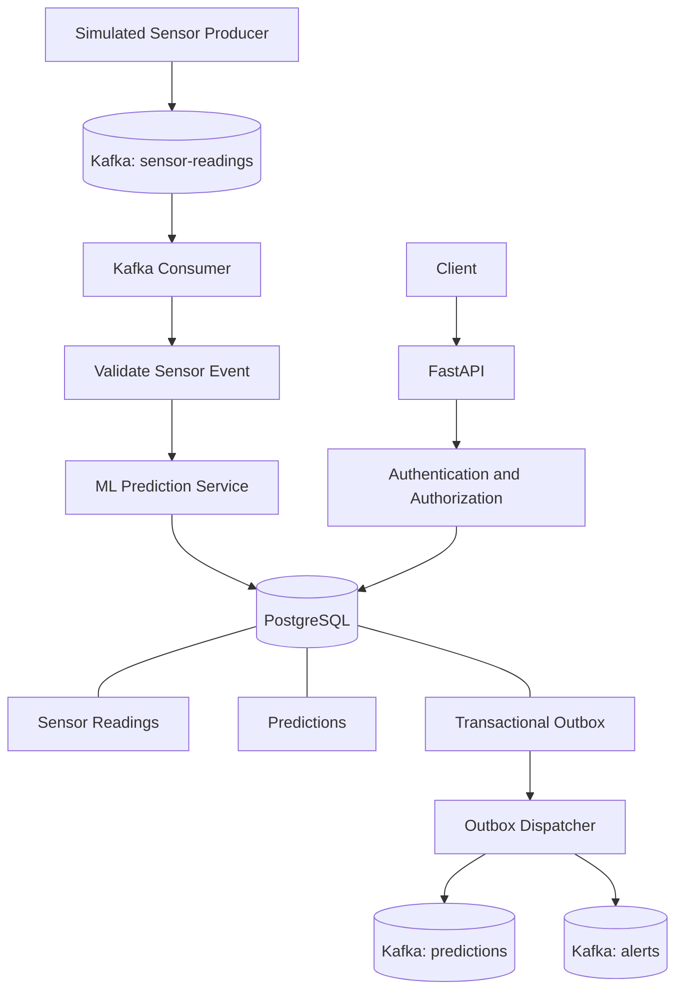

# Predictive Maintenance Platform

A machine-learning-powered predictive maintenance system that processes simulated industrial sensor data, predicts machine health, stores results in PostgreSQL, and reliably publishes downstream events using Apache Kafka and a transactional outbox.

**Project status:** Phases 1–5 implemented and merged into `main`.

## Overview

Unexpected equipment failures can cause downtime, maintenance costs, and operational disruption. This project demonstrates a streaming architecture for processing machine sensor readings, estimating machine-failure risk, and publishing prediction events.

The system combines a trained machine-learning model with Kafka-based event streaming, PostgreSQL persistence, FastAPI, authentication controls, monitoring, and Docker Compose orchestration.

**Important:** The included sensor producer generates simulated data. The project has not been verified against physical industrial sensors.

## Key Features

- Machine-failure prediction using the AI4I 2020 predictive maintenance dataset.
- A reusable ML prediction service with risk scores, machine status, and fault classification.
- Simulated sensor-event generation and Kafka streaming.
- Kafka consumer with input validation, error handling, and dead-letter support.
- PostgreSQL persistence for sensor readings, predictions, users, and alerts.
- FastAPI application endpoints and JWT-based authentication.
- Role-based access controls and login rate limiting.
- Transactional outbox for reliable downstream event publication.
- Outbox dispatcher with retry handling and delivery tracking.
- Structured JSON logging, Prometheus metrics, and health checks.
- Docker Compose services for local development and integration testing.
- Regression tests covering ML, streaming, database, authentication, and outbox behavior.

## Technology Stack

| Component | Technologies |
|---|---|
| Machine learning | Python, scikit-learn, Pandas |
| Streaming | Apache Kafka, Confluent Kafka client |
| Backend API | FastAPI, Uvicorn |
| Database | PostgreSQL, SQLAlchemy, Alembic |
| Security | JWT authentication, role-based access control |
| Monitoring | Prometheus metrics, structured logging |
| Deployment | Docker, Docker Compose |
| Testing | pytest |

## System Architecture



### Data Flow

1. The producer generates simulated machine sensor readings and publishes them to `sensor-readings`.
2. The Kafka consumer validates events and sends them to the ingestion service.
3. The prediction service evaluates the sensor readings and generates machine-health predictions.
4. PostgreSQL stores the sensor reading and prediction. The corresponding outbox event is written within the same database transaction.
5. The outbox dispatcher publishes committed events to configured downstream Kafka topics.
6. Delivery status and timestamps are recorded in PostgreSQL.

The transactional outbox avoids the dual-write problem between database persistence and Kafka publication. Publication uses **at-least-once delivery**, so duplicate events remain possible if a process fails after Kafka acknowledges a message but before the database records delivery.

## Project Phases

### Phase 1 — ML Core

- Leak-free model-training pipeline.
- Reusable prediction service.
- Risk scoring and rule-based fault classification.
- Legacy Streamlit and Flask demonstrations.

### Phase 2 — Kafka Streaming

- Simulated sensor feed.
- Kafka producer and consumer.
- Reuse of the existing prediction service for streaming inference.
- Input validation and streaming configuration.

### Phase 3 — PostgreSQL and FastAPI

- Persistent sensor readings and predictions.
- Database-backed application endpoints.
- PostgreSQL integration and schema migrations.
- API health and application functionality.

### Phase 4 — Security and Operations

- JWT authentication and role-based access control.
- Dead-letter topic and bounded publishing retries.
- Structured logging and Prometheus metrics.
- Dockerfile and Docker Compose application profile.

### Phase 5 — Transactional Outbox and Reliability

- Migration `0003_transactional_outbox`.
- Transactional persistence of prediction and alert events.
- Dedicated outbox dispatcher.
- Retry handling and delivery tracking.
- Login rate limiting.
- Operational runbook and regression tests.

## Getting Started

### Prerequisites

- Git
- Docker Desktop with Docker Compose
- Python 3.12 for local development and testing

### Run the application with Docker Compose

Clone the repository:

```powershell
git clone https://github.com/Sivabalan-21/project_predictive.git
cd project_predictive
```

Start the application profile:

```powershell
docker compose --profile app up -d --build
```

Check service status:

```powershell
docker compose ps
```

Inspect application logs:

```powershell
docker compose logs --tail=100
```

The Compose configuration starts the configured application services, including PostgreSQL, Kafka, the API, the consumer, database migration service, and outbox dispatcher.

### Generate a simulated sensor event

```powershell
docker compose --profile app run --rm consumer python -m streaming.producer --max-readings 1 --machines 1 --interval 0.1 --seed 456
```

Inspect consumer logs:

```powershell
docker compose logs --since=5m consumer
```

Check the latest outbox events:

```powershell
docker compose exec postgres psql -U postgres -d predictive_maintenance -c "SELECT event_type, topic, status, attempt_count, created_at, delivered_at FROM outbox_events ORDER BY created_at DESC LIMIT 5;"
```

A successfully delivered event should show `DELIVERED` with a populated `delivered_at` timestamp.

**Configuration note:** Use `.env.example` as the configuration reference. Review required variables and configure secrets securely for your environment. Do not commit credentials or a populated `.env` file.

## Local Python Development

Create and activate a virtual environment in PowerShell:

```powershell
python -m venv .venv
.venv\Scripts\Activate.ps1
pip install -r requirements-dev.txt
```

Train the ML models:

```powershell
python -m ml.training.train
```

Run the Streamlit demonstration:

```powershell
streamlit run app/main.py
```

Or run the Flask demonstration:

```powershell
python flask_app/app.py
```

These commands support the legacy demonstrations and local development. Use the Docker Compose instructions above for the integrated Kafka and PostgreSQL pipeline.

## Testing

Run the full test suite:

```powershell
python -m pytest -q
```

### Verified test result

The completed Phase 5 development run reported:

- **535 passed**
- **4 skipped**
- **0 failed**

The full suite completed in approximately 10 minutes and 21 seconds. The reported result is from the development environment; run the tests again when making subsequent changes.

Whitespace validation:

```powershell
git diff --check
```

Live integration verification confirmed that a simulated sensor event was processed, a prediction was stored, and the corresponding outbox event reached `DELIVERED`.

## Observability and Operations

The application includes structured logs, service health checks, and Prometheus metrics. Use Docker Compose to inspect service status and logs.

Operational documentation:

- [Architecture](docs/architecture.md)
- [Authentication](docs/auth.md)
- [Kafka streaming and delivery](docs/kafka.md)
- [Observability](docs/observability.md)
- [Operations runbook](docs/operations-runbook.md)

## Limitations

- Sensor events are simulated, not captured from physical equipment.
- Model performance depends on the dataset, training process, and decision thresholds.
- Predictions are estimates and should not be treated as guarantees that a machine will or will not fail.
- Kafka delivery is at least once; downstream consumers may need deduplication.
- Local Docker Compose verification does not establish production deployment readiness.
- Physical sensor integration, production infrastructure, and broader operational validation are future extensions.

## Future Improvements

- Integrate real IoT sensors or a hardware simulator.
- Build a dashboard for live machine status, risk scores, and alerts.
- Evaluate false positives and missed failures using realistic operational data.
- Add Remaining Useful Life (RUL) estimation.
- Add production deployment, centralized monitoring, and automated recovery tests.

## Dataset and Attribution

The project uses the AI4I 2020 Predictive Maintenance dataset. Consult the [UCI Machine Learning Repository](https://archive.ics.uci.edu/dataset/601/ai4i+2020+predictive+maintenance+dataset) for the dataset's attribution and licensing information before redistributing the data.

## Author

**Sivabalan A**

- GitHub: [Sivabalan-21](https://github.com/Sivabalan-21)
- Project repository: [project_predictive](https://github.com/Sivabalan-21/project_predictive)
